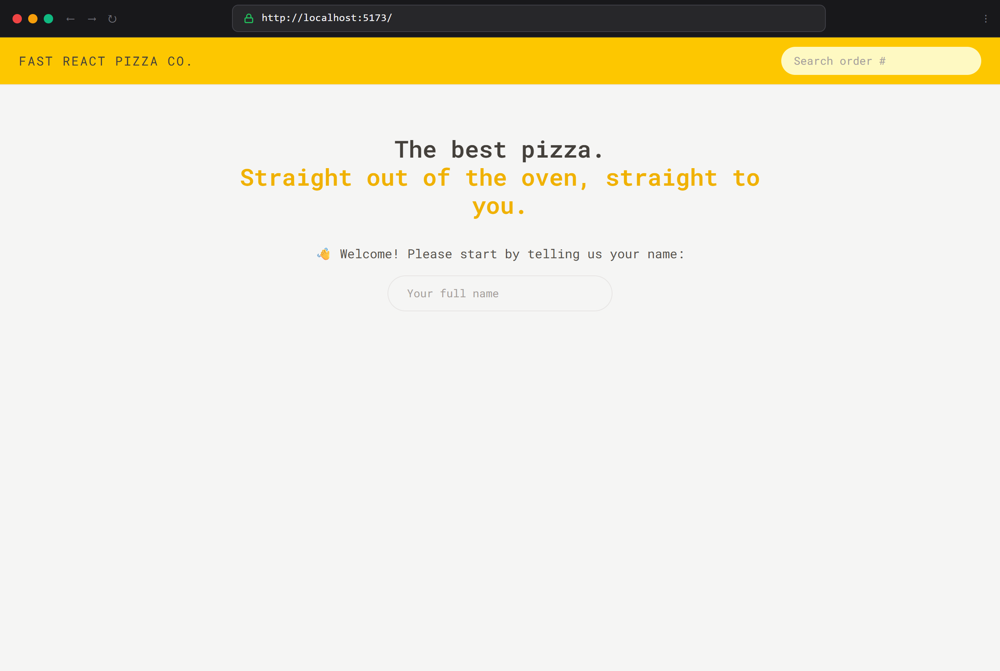
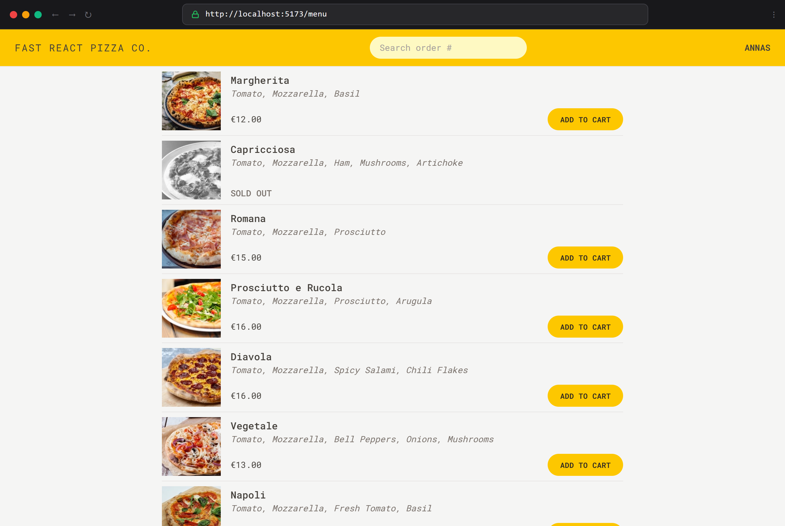
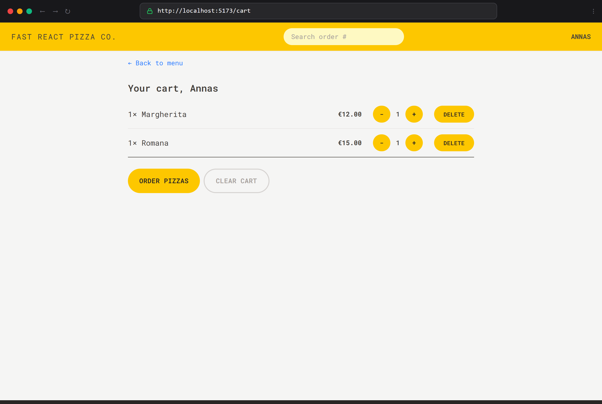
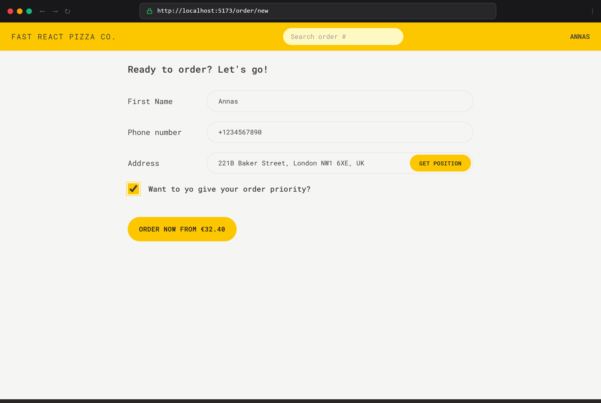
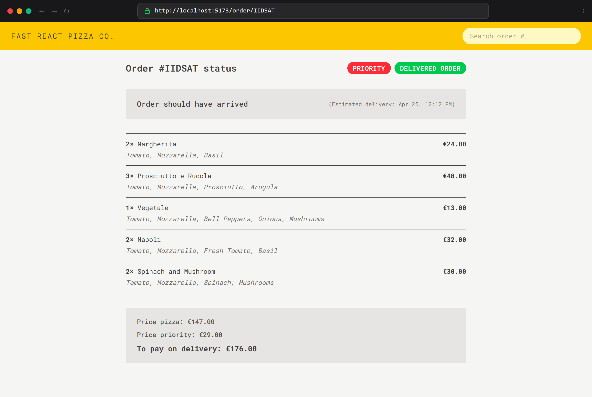

# 🍕 Fast React Pizza Co.

[](https://fast-react-pizza-annasfaruqui.netlify.app/)

[](https://react.dev/)
[](https://www.typescriptlang.org/)
[](https://redux-toolkit.js.org/)
[](https://reactrouter.com/)
[](https://tailwindcss.com/)
[](https://vite.dev/)

> 🌐 **Live Website:** [https://fast-react-pizza-annasfaruqui.netlify.app/](https://fast-react-pizza-annasfaruqui.netlify.app/)

A modern, fast, and feature-complete pizza ordering single-page application (SPA). Built with **React 19**, **TypeScript**, **Redux Toolkit**, and **React Router Data APIs (v7)**, styled with **Tailwind CSS v4**, and bundled with **Vite**.

This application simulates a streamlined restaurant delivery service—allowing customers to personalize their profile, browse an active pizza menu, manage a dynamic shopping cart, auto-detect their delivery location using GPS reverse geocoding, submit orders, and track order status in real time.

---

## 📸 Application Showcase

Here is a visual walkthrough of the application in action across its key routes and features:

### 1. Welcome & Customer Onboarding
> **Route:** `http://localhost:5173/`  
> Customers start by entering their name to begin ordering, which initializes the global user state in Redux.



---

### 2. Live Pizza Menu
> **Route:** `http://localhost:5173/menu`  
> The menu loads asynchronously before rendering via React Router loaders. It shows pizza images, prices, ingredients, and "Sold Out" badges, with instant "Add to Cart" interactions.



---

### 3. Shopping Cart Management
> **Route:** `http://localhost:5173/cart`  
> Features real-time cart mutations—increment/decrement quantity, delete items, clear cart, and instant order cost calculation.



---

### 4. Order Checkout & GPS Reverse Geocoding
> **Route:** `http://localhost:5173/order/new`  
> Validates user input (phone regex, required fields) and offers single-click **"Get Position"** to fetch GPS coordinates and reverse-geocode the user's physical street address. Users can also select priority rush delivery.



---

### 5. Live Order Status & Priority Upgrades
> **Route:** `http://localhost:5173/order/:orderId` (e.g. `IIDSAT`)  
> Displays order receipts, estimated delivery countdowns, ordered items with ingredients fetched in parallel via `useFetcher`, and allows customers to upgrade an existing order to **Priority** with background PATCH mutations.



---

## 🎯 What This Project Is About

**Fast React Pizza Co.** was engineered to explore modern, real-world frontend web development patterns without relying on unnecessary external bloatware:

* **Eliminating Fetch Waterfalls:** Replaced traditional `useEffect` data fetching with React Router Data APIs (`createBrowserRouter`, `loader`, `action`). Data is fetched in parallel while the route transitions, preventing layout jumps and spinner flicker.
* **Predictable Global State:** Centralized Cart and User domains using Redux Toolkit slices with pre-typed hooks (`useAppSelector`, `useAppDispatch`), keeping application state clean, immutable, and fully typed.
* **Asynchronous Background Synchronization:** Utilizes `useFetcher` to load ingredient metadata and patch priority status for existing orders behind the scenes without triggering page reloads.
* **Real-World Geolocation:** Integrates browser Geolocation APIs with external reverse-geocoding services via Redux Thunks.

For a file-by-file technical breakdown and TypeScript explanation, see [ARCHITECTURE.md](ARCHITECTURE.md).

---

## 🛠️ Tech Stack & Key Libraries

| Technology | Role |
| :--- | :--- |
| **React 19** | Component-driven UI library |
| **TypeScript 5.8** | Compile-time type safety, custom interfaces, and utility types |
| **Redux Toolkit 2.12** | Global state management (`user` and `cart` slices, asynchronous thunks) |
| **React Router v7** | Routing with Data APIs (`loader`, `action`, `useFetcher`, `redirect`) |
| **Tailwind CSS v4** | Modern utility-first responsive styling and typography |
| **Vite 8.2** | Lightning-fast development server and optimized production bundler |

---

## 📁 Project Architecture

The project follows a **Feature-Sliced Design** structure, separating code by business domain rather than purely technical roles:

```text
fast-react-pizza/
├── public/
│   └── screenshots/              # Application screenshots showcasing live views
├── src/
│   ├── features/
│   │   ├── cart/                 # Cart components, cartSlice, quantity controls
│   │   ├── menu/                 # Menu listing, MenuItem cards, menu loaders
│   │   ├── order/                # Order creation, order receipt, priority updates
│   │   └── user/                 # User onboarding, username displays, userSlice thunks
│   ├── services/
│   │   ├── apiGeocoding.ts       # Reverse geocoding API client (BigDataCloud)
│   │   └── apiRestaurant.ts      # Menu & order REST API client
│   ├── ui/                       # Shared UI components (AppLayout, Button, Loader, Error)
│   ├── utils/                    # Formatting helpers (currencies, dates, time calculations)
│   ├── App.tsx                   # Central router configuration with loaders & actions
│   ├── hooks.ts                  # Type-safe Redux useDispatch & useSelector hooks
│   ├── store.ts                  # Configured Redux Toolkit store and root types
│   ├── types.ts                  # Central TypeScript domain interfaces
│   └── main.tsx                  # Application entry point
├── ARCHITECTURE.md               # Detailed code & TypeScript walkthrough
└── package.json                  # Scripts and dependencies
```

---

## 🚀 How to Run Locally

### 1. Prerequisites
Ensure you have [Node.js](https://nodejs.org/) installed (v18+ recommended).

### 2. Clone the Repository
```bash
git clone https://github.com/your-username/fast-react-pizza.git
cd fast-react-pizza
```

### 3. Install Dependencies
```bash
npm install
```

### 4. Start the Development Server
```bash
npm run dev
```

The application will start locally at:
```text
http://localhost:5173/
```

### 5. Build for Production
To verify TypeScript compilation and create an optimized production build:
```bash
npm run build
```

To preview the production build locally:
```bash
npm run preview
```

---

## 🙏 Credits & Acknowledgements

* **Original Concept & Instructor:** This project is inspired by the pizza ordering application designed by **[Jonas Schmedtmann](https://jonas.io/)** in his course **[The Ultimate React Course: React, Next.js, Redux & More](https://www.udemy.com/course/the-ultimate-react-course/)**. Huge thanks to Jonas for creating the original UI design, project specifications, and hosting the mock restaurant API.
* **TypeScript Re-architecture:** Jonas's original course teaches this project in JavaScript (JS). I leveraged his project concept and expanded upon his teachings to architect and build this entire project from scratch in **TypeScript (TS)**. This allowed me to dive deep into advanced TypeScript patterns—such as strictly typed Redux Toolkit slices (`.withTypes<T>()`), React Router v7 Data APIs (`ActionFunctionArgs`, `LoaderFunctionArgs`), domain interface modeling, and compile-time type safety across the entire application.

